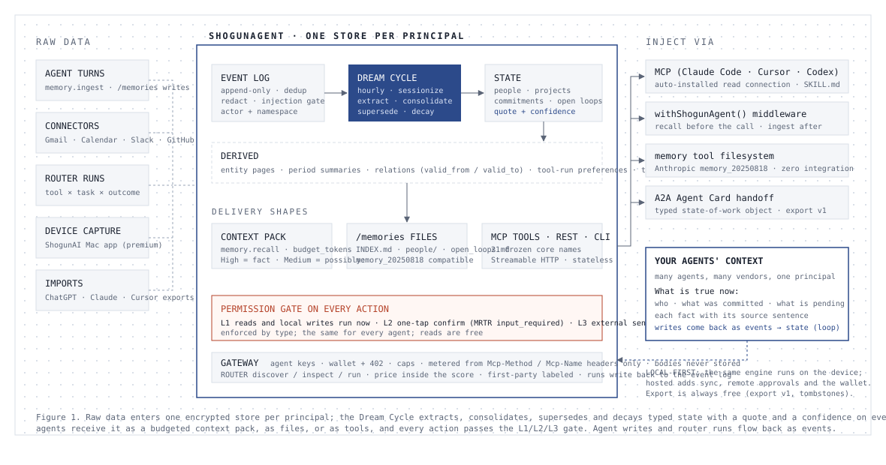

# ShogunAgent

**AI エージェントのための状態レイヤー。**

> Memory remembers. State knows.
> 記憶は覚える。状態は知っている。

[English version / 英語版](./README.md)

このリポジトリは ShogunAgent の方針・調査・（これから）コードを置く場所です。ShogunAgent は [ShogunAI](https://github.com/Torutesu/ShogunAI-) の中にある状態推定と権限のエンジンを、人間ではなく AI エージェント向けにサービスとして提供するものです。以下の決定は 2026 年 10 月時点のもので、`reports/` 内の初期ドラフトより優先します。

---

## 1. 何であるか

多くの AI エージェントを動かすチームに対して、ShogunAgent は全エージェントに「ユーザーの仕事の校正済みモデル」（人・プロジェクト・コミットメント・オープンループ）を 1 つ与える共有状態レイヤーです。全ての事実に根拠（provenance）が付き、結果を伴う全ての行動に人間のゲートが掛かります。

自由文をベンダーのクラウドに保存するメモリ API と違い、**型付き・権限階層付き・ローカルファースト・可搬**です。

メモリ API ではありません。「エージェント向けメモリ」は飽和したカテゴリ（Mem0、Zep、Letta、supermemory、Cognee、Engram）で、ラボは個人化記憶を無料で出しています（OpenAI Dreaming、Anthropic Managed Agents memory、Google Memory Bank、AWS AgentCore、Microsoft Copilot）。ShogunAgent は別のカテゴリを名乗ります。エージェントが何を覚えているかではなく、いま何が真実か。

## 2. バリュープロポジション（3 本柱。増やさない）

| 柱 | 主張 | コードベース上の証明 | 競合が持たないもの |
|---|---|---|---|
| **Typed state, not text memory** | 全ての事実は型付きの行で、元イベントからの逐語 quote と confidence を持つ。新しい事実が古い事実を置き換え、矛盾は明示され、confidence は時間で減衰する | `state_provenance` が空の書き込みはリポジトリ層が拒否。High / Medium / Low のバンドを `shogun-fusion/confidence.rs` の 1 箇所で強制。loop consolidator は quote の完全一致と confidence 0.84 以上が無ければ保存しない | supermemory は自ら「system of record ではない。SQL も join も主キーも無い」と明言。Mem0 と Zep は自由文の fact ストア |
| **Permission tiers on every action** | 読み取りは即時（L1）。ユーザーデータに触る書き込みは一押し確認（L2）。外部送信と決済は明示的な人間承認（L3）。型で強制され、どのエージェントにも同じ | `shogun-agents` の `SendAction` は型で L3。MCP の `readOnlyHint` / `destructiveHint` / `openWorldHint` と MRTR の `input_required` / URL elicitation に 1 対 1 で写像 | エージェントの権限プロンプトの 93% は読まれずに承認されている。競合の権限は read / write の 2 値 |
| **Local-first, open, portable** | データは既定で端末を出ない。クラウド経路は本文を保持しない。エンジンは OSS。状態は公開形式でエクスポートできる | ゼロ保持の中継（traceability log に本文カラムが無い）。秘密情報の redaction は recall 1.0、誤検知 0。ユーザー保持鍵 | 資金調達済みベンダーは全てクラウドファースト。supermemory の OSS はクライアントのみでエンジンは非公開。試験された 7 製品中 7 製品がロックイン |

**ルーターの位置づけ（1 行）**：エージェントのための 1 つのエンドポイント。ツールを見つけ、権限階層の下で実行し、学んだことを自分の状態として持つ。

**価格（1 行）**：読み取りは無料。取り込んだ分と実行した分だけ払う。

### メッセージの階層

- **3 語**：The state layer for agents.
- **1 文**：Calibrated truth about your work (people, projects, commitments, open loops) with provenance on every fact and a human gate on every send, shared across all your agents.
- **開発者向け 30 秒**：あなたのエージェントは毎セッションをゼロから始め、聞かずに行動する。ShogunAgent は MCP 越しに、型付きで根拠付きのユーザーの仕事のモデルを 1 つ与え、全行動に 3 段階の権限を掛け、データを既定で端末に留め、全てを公開形式でエクスポートする。読み取りは無料、取り込みと実行の分だけ払う。
- **CTO 向け 30 秒**：エージェントの失敗は文脈の失敗と権限の失敗である。ShogunAgent はエージェントが仕事について信じていることの system of record で、全事実の裏に quote、全行に confidence、全外部送信に人間の承認がある。許可なく端末を出るものは無く、ロックインも無い。

### 使わない言葉

「AI OS」、「ワールドモデル」（ロボティクスの用法と衝突）、カテゴリ名としての「メモリ」、「ベンチマーク #1」（信頼を失った言葉。同一ハーネスの結果だけを公開する）、地域固有のコンプライアンス文脈。

## 3. 状態の取得と供給



*図 1. 生データは principal ごとの暗号化ストアに入り、Dream Cycle が全行に quote と confidence を持つ型付き状態に変える。エージェントは context pack・ファイル・ツールとして受け取り、全ての行動は L1/L2/L3 のゲートを通る。エージェントの書き込みとルーターの実行はイベントとして戻る。*

取得は 5 系統で、全て同じ append-only の `event_log`（dedup、redaction、instruction-shaped ゲート）に落ちます。

| 系統 | 中身 | 必要なもの |
|---|---|---|
| エージェントからの ingest（主経路） | 会話ターン、ツール結果、タスク進行。`memory.ingest` と Anthropic memory tool 互換の `/memories` 書き込み | 無し。全エージェント |
| コネクタ pull | Gmail、Calendar、Slack、GitHub、Linear、Notion を OAuth で | `shogun-integrations` |
| ルーター実行ログ | ルーターを通る全 run の tool × task × outcome | ルーターを持つこと |
| 端末取得（premium） | Accessibility API のテキスト、Visual recall の OCR、会議の文字起こし | ShogunAI Mac アプリ |
| インポート | ChatGPT / Claude / Cursor のエクスポート | `shogun-memory-import/v1` |

推定は ShogunAI のパイプラインそのまま：毎時の Dream Cycle（セッション化、prefilter、スキーマ強制の抽出）→ quote と confidence 付きの state tables → consolidator → entity pages と期間要約。

供給は 3 形状。2026 年のエージェントが実際に呼ぶ形だからです：予算付き context pack（`get_context_pack`。High は事実、Medium は「possibly」、Low は除外）、仮想ファイルシステム（`/memories/people/<name>.md`、`/memories/open_loops.md`。Anthropic の memory tool が統合ゼロで読む）、MCP ツール（`state.*`、`recall`、`search`）と A2A Agent Card。

ShogunAgent は model-agnostic です。自社の LLM 利用は抽出と統合だけで、安い Batch レーンで行います。

## 4. モデルレイヤー各社との関係

**各社が確実に取り、我々が争わない領域**：自社製品内の個人化記憶、自社 API 内のセッション状態、保存の単価競争。

**各社が構造的に行かず、我々が立つ領域**：ベンダー横断の状態（どのラボも他社エージェントの中立な記録係にならない）、可搬性（ロックインが彼らの収益構造）、異なるベンダーのエージェントを跨ぐ人間承認の統治、端末レベルの真実。

**付き合い方**：顧客であり供給者であり、競合しない。Anthropic の memory tool はストレージ非依存なので我々がその裏側になる。Claude Code プラグイン、Anthropic directory、MCP Registry に載る。OpenAI：Plugin directory と Agents SDK ミドルウェア。Google：ADK と Vertex の memory インターフェース。AWS：AgentCore の self-managed memory 枝の外部ストア。Microsoft Copilot の communication memory が最も近い比較対象で、M365 の外のエージェントに同じものを提供する。

**警戒**：Anthropic Cowork / Claude Desktop の端末文脈への進出、OpenAI Dreaming の個人化から仕事の状態への拡張、Microsoft が communication memory を Foundry 経由で開くこと。いずれも 1 ベンダー内の拡張であり、ユーザーが混ぜるベンダーが増えるほど我々の価値は上がる。

## 5. 競合の層別

| 層 | プレイヤー | 差 | 立場 |
|---|---|---|---|
| メモリ API | Mem0、Zep、Letta、supermemory、Cognee、Engram | 型付き状態 vs 自由文。3 段階 vs read/write。ローカル既定 vs クラウド既定。開いたエンジン vs 閉じたエンジン | 直接競合。別カテゴリを名乗る |
| ルーター・レジストリ | Monid、Composio、Arcade + Smithery、Glama、Coinbase Agentic Market | 権限階層が無い。状態を持たない | 自前ルーターを入口に建て、全てに載る |
| 企業コンテキスト基盤 | Microsoft Copilot、Glean、Jedify、Interloom | スイートやデータ基盤に閉じる。エージェント中立でない。人間のゲートが無い | 本当の比較対象。ここで勝つ |
| 取得層 | Screenpipe、Limitless（Meta）、Rewind（停止） | 取得して保存するだけで状態を推定しない | ほぼ退場。教訓：生の記録には誰も払わない |

## 6. MOAT（強い順、正直に）

1. **二面市場での位置**。ツール供給側はルーターに、エージェントは MCP に接続する。コネクタが増える → エージェントが増える → 実行データが増える → `discover` が良くなる → エージェントが増える。このループには状態層が必要で、ルーター単体では回らない。
2. **複利する状態**。動かし続けるほど状態の精度が上がる。事実は自由にエクスポートできるが、校正された confidence と学習パターンは観測の継続からしか生まれない。ロックインではなく継続の価値。
3. **信頼**。ゼロ保持、全行の provenance、6 種の評価ハーネス、書き込み経路での OWASP ASI06 緩和。企業の信頼は監査と時間で稼ぐもので、買えない。
4. **端末レベルの真実**。ラボもメモリ各社も持たない Accessibility と Visual recall の取得層。プラットフォームを足すほど強くなる。
5. **標準**。エクスポート形式と権限階層の分類を W3C memory interop CG と MCP アノテーションに持ち込み、参照実装になる。
6. **工学の先行**。約 33 万行の Rust、校正ルール、91 本のマイグレーション。壁ではなくリード。

**MOAT ではないもの**：ルーターのコード（MIT、780 フォーク）、メモリ API の形、ベンチマークのスコア、モデルへのアクセス。

## 7. プロダクト上の決定

### 「OpenRouter for Agents」を入口として建てる

オーナー決定。調査の警告（コネクタ・コードはコモディティ、中央値 $0.0015/call、Arcade と Stripe による統合、自社製品を自分で順位付けする利益相反、記憶はスポット市場に合わない）は事実のまま残り、設計条件になります。

1. **二層構造**。Router（discover / inspect / run、従量、ゼロ保持プロキシ）は粗利ほぼゼロで良い。収益は ingest と状態で測る。ルーターの KPI は「ルーター経由エージェントのうち状態層を使い始めた割合」。
2. **コールドスタートは借りる**。Monid 互換のコネクタ定義で既存の端点定義を取り込み、Monid の hosted カタログをパススルー。自前コネクタは差別化する領域（記憶・状態、承認を要する書き込み）だけ。
3. **全 run に L1/L2/L3**。読み取りは L1、ユーザーデータの書き込みは L2、外部送信と決済は L3。`scope.rs` の「表に無い操作は拒否、ExternalSend は必ず L3」をそのまま載せる。
4. **ルーターはユーザー所有の状態で学ぶ**。tool × task × outcome を ShogunAgent の状態に記録し、`discover` をユーザー・テナント別に個別化する。可搬で、中央集権しない。
5. **自己優遇しない**。スコア内訳に価格を含めて公開、first-party ラベル、ディレクトリ提出物とルーターの SKILL.md を分離。

### 価格：完全従量

固定サブスク無し。プリペイド・クレジット、残高 0 で `402`、キー別・エージェント別のハード上限を初日から。

| 計量項目 | 単価（すべて推定） | 備考 |
|---|---|---|
| ツール実行（他社プロバイダ） | プロバイダ価格 + 5% | 失敗・0 件は $0 |
| ツール実行（自社コネクタ） | $0.002 / call | 書き込みは L2/L3 を経て同額 |
| 取り込み（ingest） | $0.50 / 1K イベント | 抽出 LLM 原価を含む |
| モデル起動 op | $0.10 / 1K | consolidation、AI 検索、entity page |
| 状態の読み取り | $0 | `state.*`、`get_context_pack`、`recall`、`search` |
| 遠隔 L2/L3 承認 | $0 | |
| ホスト保存 | $0.10 / GB-月 | 削除・エクスポートは常時無料 |
| Local（OSS） | $0 | |
| Enterprise | 同じ従量、年間コミットで 10〜25% 割引 | BYOC / ZDR / SSO / 監査を含む。座席課金はしない |

粗利目標：ingest は原価の 3〜5 倍、run は 5% テイクで損益ゼロ近傍。design partner の実測で改定する。

### 建てないもの

価格だけで競う汎用ルーター。独自決済基盤と x402 ウォレット（Stripe + 402 規約。x402 は後段で判断）。グラフ DB（SQLite の型付き関係行で足りる）。Postgres 移植（再利用率が 60〜70% から 25% に落ちる）。独自埋め込み研究。チャット個人化メモリ API。LoCoMo のスコア追い。取り込み API より先の Windows / モバイル取得層。消費者向けアプリやブラウザ拡張。158 ツール全公開（デスクトップ固有の約 100 本は ShogunAI に残す）。

## 8. GTM：開発者と個人から、OSS を装置に

**誰に、どの順で**：(1) コーディングエージェントのパワーユーザー（Claude Code、Codex、Cursor）、(2) エージェント製品を作る開発者（Agents SDK、Vercel AI SDK、Mastra、LangGraph）、(3) 複数エージェントを回す小チーム、(4) 2〜3 から昇格した企業。消費者向け記憶製品は全て退場したので、一般消費者ではなく「毎日エージェントを動かす人」に売る。ShogunAI の既存 Mac ユーザーは初日のコホート。彼らのエージェントには既に read 接続が自動投入されている。

**開く**：エンジン（state tables、confidence、consolidator、Dream Cycle）、ローカル MCP / REST / CLI、コネクタ定義とルーターのエンジン、SKILL.md、エクスポート形式、評価ハーネス 6 種。ライセンスは Apache-2.0。**閉じる**：hosted sync、遠隔承認、ウォレットと課金、hosted ルーターカタログとプロバイダ契約。ファネルは「ローカルとホストで同じ API、`baseURL` を変えるだけ」。supermemory と違い、エンジンそのものを開く。

**OSS ローンチの実務**：10 秒で動く README の GIF（`npx shogunagent` で、あなたのコーディングエージェントがオープンループを知っている）。Show HN は機能一覧ではなく再現可能な主張（同一ハーネス結果、監査型の記事）で。ベンチマークのハーネスを公開し、競合の数値を再現可能にする。「open-loop tracking」ベンチをコミュニティに提供する。コネクタ定義を貢献の低摩擦な入口にする。

**エージェントが自分で導入する経路**：SKILL.md、`npx shogunagent help --json`、docs MCP、`llms.txt`。エージェントが自分で導入し、自分のプリペイド予算内で使う。

**プラットフォームの棚（全部、英語で、最初に）**：Claude Code プラグイン → Anthropic directory。公式 MCP Registry。Cursor / Windsurf の MCP 設定。OpenAI Plugin directory。Glama、Smithery、Composio toolkit、Monid（記憶カテゴリができたら）。

**1 行統合**：`withShogunAgent()` を Vercel AI SDK、OpenAI Agents SDK、Claude Agent SDK、Mastra、LangGraph、CrewAI に。Mem0 の API 利用 5 倍成長の主因。

**やらないこと**：有料広告、SEO 先行、カンファレンスのブース、企業営業の先行。

**転換の階段**：OSS ローカル（$0）→ hosted sync（2 台目の端末やエージェント）→ ウォレット入金（コネクタ ingest、ルーター run）→ チーム（共有状態、遠隔承認）→ 企業（BYOC、ZDR、監査）。最初の 2 段は無料で信頼と量を作り、収益は 3 段目から。

## 9. ロードマップ（順序のみ。期間は置かない）

AI 前提で開発する。フェーズは順序と出口条件だけで定義し、日数や月数は書かない。

| フェーズ | 到達点 | 出口条件（推定） |
|---|---|---|
| **1. コアとルーター骨格** | `shogunagent-core` を Linux で単体起動（テナント別 SQLite）。Streamable HTTP MCP core 21 本。API key 認証。`/memories` 射影。エクスポート形式 v1。OSS 公開。ルーター：discover / inspect / run、Monid 互換コネクタ、hosted パススルー、記憶・状態カテゴリ、キー別上限、全 run に L1/L2/L3。プリペイド・クレジットと 402。SKILL.md、Claude Code プラグイン、MCP Registry と Glama 掲載。同一ハーネス結果公開。ShogunAI Mac の Memory API をブランド統合 | 外部エージェントからの `tools/call` が継続的に流れる。design partner 契約。ベンチマーク公開 1 本。ルーター → 状態層の転換率が計測できている |
| **2. 承認・SDK・課金・カタログ** | 遠隔 L2/L3 承認（Web、Slack、webhook）。A2A Agent Card。TS/Python SDK と `withShogunAgent()`。agent-scratch 名前空間と ACL・監査。Stripe 従量課金とウォレット。個別化 `discover`。プロバイダのセルフサーブ掲載。Anthropic と OpenAI のディレクトリ。ローカル埋め込み | 有料ウォレット利用者が増え続ける。ingest 粗利が原価の 3 倍以上。LLM 原価 ≤ 売上の 15%。転換率が改善 |
| **3. Enterprise・標準・決済** | Enterprise コミット契約（BYOC、SSO/SCIM、監査エクスポート、ZDR）。W3C memory interop CG とエクスポート形式 v2。open-loop ベンチ v1 の公開。プロバイダ支払いとカタログ一般公開。x402 の判断。資金調達 | Enterprise 契約。NRR > 110%。同一ハーネスで multi-session / temporal 上位 3。自前コネクタ比率の上昇 |

## 10. ShogunAI から持ち越すもの

行数で 30〜40%、難しい部分で 70% 以上。

再利用：`shogun-memory`（state tables、`state_provenance`、loops、entity pages、federated search、sanitize、traceability、import。V1〜V91 を SQLite のまま使い、`tenant_id` / `uid` / `actor` を加算マイグレーションで足す）、`shogun-fusion`、`shogun-agents`、`shogun-redact`、`shogun-license`（verify）、`shogun-mcp`（`MemoryBackend`、`ApiLevel`、toolsets、source policy、rate limit、REST routing。Keychain 依存の設定と launcher check は環境変数と `apps/api` のトークンに差し替え）、`shogun-core` の中立部（dreamcycle、llm、ai_search、context、`shogun_api` / `shogun_mcp` バイナリ）、`apps/api`（Ed25519 認証、reserve-then-settle 計量、ゼロ保持ロガー）。

持ち越さない：macOS の取得層、Keychain 依存の秘密、Tauri デスクトップ、単一テナント前提。

最短経路：`shogun_api` バイナリをテナント別の SQLCipher ファイルで多重化し、前段に `apps/api` を置いて認証と計量を行う。

## 11. エージェント・コマース：Day 1 から「エージェントに選ばれる」設計

買い手は人ではなくエージェントになっていく。エージェントはサービスを見つけ、価格・レイテンシ・健全性・信頼で比較し、自分で導入し、予算の中で払い、最初の数回の呼び出しの結果で再選択か離脱かを決める。この全段階を最初のリリースから設計対象にする。

### 原則

1. **設定ゼロの初回呼び出し。** キーの無いエージェントでも `discover`、`inspect`、狭い範囲の読み取りは呼べる。最初の書き込みや従量の実行で `402` を返し、進むのに必要な情報を全部載せる。価値を見る前に人を要求しない。
2. **全レスポンスが自己記述。** 各結果に `usage`（コストと単位）、`latency_ms`、エラー時の `next_action`（何が失敗したかではなく何をすべきか）、`hints`（より安い・より適した代替。ルーター内の他社コネクタも含む）を付ける。エージェントの選択ループは不透明な失敗を罰する。正直さが継続率の仕組みになる。
3. **全ての well-known な場所で機械可読。** エージェントが見るあらゆる場所に同じ identity・同じツール名・同じスキーマを置く。人向けドキュメントは機械向けから生成し、逆はしない。
4. **説明文はマーケティングではなくランキングのために書く。** レジストリとルーターは説明文で順位を付ける。ツールの説明はエージェントがやろうとしているタスクを名指しし（「ユーザーが何を約束したかを探す」「この人との間で何が保留か」「ツールを実行して結果を状態として残す」）、除外も書く（「チャットの逐語保存には使わない」）。説明文は推測ではなく計測で決める（下記の選択 eval）。
5. **人の承認は最大 1 回、金のときだけ。** カードは URL モードの elicitation で一度だけ紐付け、以降はエージェントが上限内で使う。読み取りは一切聞かない。権限階層（L1/L2/L3）はユーザーの世界への行動を、予算上限は支出を統治する。二つは別物で、どちらも行動前にエージェントから見える。
6. **安定性はエージェントが計測できる機能。** wire name の凍結、公開された非推奨ポリシー、全書き込みの idempotency key、一覧の `ttlMs`、`Retry-After` の遵守、公開されたインシデント履歴。一度焼かれたエージェントは戻ってこない。

### Day 1 の成果物

| 面 | 出すもの | エージェントがそれを必要とする理由 |
|---|---|---|
| `/.well-known/mcp/server-card.json` | MCP Server Card：エンドポイント、認証、アノテーション付きツール一覧 | ハンドシェイク無しの段階的発見 |
| MCP Registry の `server.json` | 正規のレジストリ登録 | Claude Code、Cursor、ゲートウェイが最初に見る場所 |
| `/.well-known/agent-card.json` | 署名付き A2A Agent Card | 組織間の引き渡しと identity |
| `llms.txt` と `llms-full.txt` | エージェント可読のドキュメント索引 | エージェントは人より先にドキュメントを読む |
| `SKILL.md` | トリガー条件と非トリガー例外、setup、認証、優先順位、コスト警告、ステータスの意味、L2/L3 の意味、番号付きルール | エージェントが自分で導入し運用する |
| `openapi.json` | REST 面の OpenAPI 3.1 | コードを生成するエージェント |
| `/.well-known/pricing.json` | 機械可読の料金表、無料枠、上限 | 初回呼び出し前の価格比較 |
| `/health` と `/.well-known/status.json` | ライブの p50 / p95、エラー率、インシデント履歴 | 健全性で重み付けするランキング |
| `benchmarks.json` | reader、judge、seed、1 回答あたりコストを含む同一ハーネス結果 | 再実行できる信頼シグナル |
| `quote` エンドポイントと全従量呼び出しの `dryRun` | 確定前の正確なコスト | 予算を持つエージェントは不明なコストを拒む |
| 402 ペイロード | 金額、単位、受け付ける決済手段、人の承認 URL、`Retry-After` | サポート無しのセルフ入金 |
| `POST /v1/agents` | エージェントの自己登録：スコープ付きキーと無料枠を返す。レート制限と不正対策あり、メール不要 | フォーム無しの導入 |
| キー内の紹介属性 | `ref` を紹介したエージェントまたは開発者のウォレットに還元 | エージェントがチャネルになる |

### 決済の設計

Stripe で精算するプリペイド・ウォレット。`402` レスポンスは x402 の payment-required 形式に従い、オンチェーン決済を受け付ける前からウォレットを持つエージェントが読めるようにする。キー別・エージェント別のハード上限（日次・月次）は必須で、既定は保守的な値。レシートは呼び出しごとに機械可読。失敗と 0 件は無料。異議申し立ては API であり、メールではない。

### 選択 eval：本当に重要な指標

CI から回すハーネス。タスク記述を与えたとき、Claude・GPT・Gemini・オープンモデルは、Mem0・supermemory・Zep・ルーター内の代替と並んだ ShogunAgent を、MCP Registry の掲載文・Claude Code プラグインの説明・OpenAI Plugin の掲載文・ルーターの `discover` のそれぞれでどれだけ選ぶか。結果は面ごと・モデルごとの選択率。説明文の変更はこの数字が落ちないときだけ出す。これはエージェント時代のコンバージョン率最適化で、このカテゴリで誰もやっていない。

### 自前ルーターの中で選ばれること

ルーターは他社ツールと自社コネクタを同じ公開スコア（タスク適合、価格、健全性、レイテンシ）で順位付けし、first-party はラベルで区別し、自己優遇しないポリシーを文書化する。状態層は競合ツールとして掲載しない。全ての run が書き込む基盤である。エージェントはルーターの中でツールを選び、結果がユーザーの状態として残るからルーターを選ぶ。

## リポジトリ構成

```
README.md                  本文書（英語）
README.ja.md               本文書（日本語）
CLAUDE.md                  このリポジトリで作業する際のルール
crates/                    ShogunAI から移行した Rust ワークスペース（エンジン、MCP/REST/CLI、評価）
apps/api/                  ゲートウェイと中継（Cloudflare Workers + Postgres 上の Hono）
packages/config/           共有設定
scripts/                   不変条件ガードと feature matrix 実行スクリプト
docs/implementation-plan.md  フェーズごとのエピックとタスク、受け入れ条件
docs/MIGRATION.md          ShogunAI から何を移行し、何を移行せず、なぜか
docs/migrations/           マイグレーションごとのロールバック手順
docs/mcp/                  Memory API のアーキテクチャ・ノート
docs/shogunai-origin/      ShogunAI 設計文書の参照コピー
reports/                   方針レポート全文（Markdown と日英 HTML）
research_notes/            出典付きの調査ノート 7 本
```

## 未解決の問い

- Mac アプリを持たない開発者は、取り込み API だけで十分な状態を得られるか
- ルーター経由のエージェントは、ルーターを正当化する率で状態層に転換するか
- W3C の相互運用プロセスでどのエクスポート形式が勝ち、我々のものがそれになれるか

3 つとも、追加の調査ではなく design partner の実測で答えが出る。
