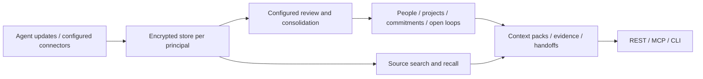

# ShogunAgent

**The state layer for AI agents:** shared people, projects, commitments and open work, with source evidence and approval controls.

ShogunAgent lets multiple agents use the same encrypted work history and reviewed state through REST, MCP and CLI interfaces. Save a conversation or task update, retrieve its sources, and—after configuring processing—track what changed and what still needs attention. Consequential external actions require human approval.

[Quickstart](#quickstart-save-and-recall-a-source) · [Connect an agent](docs/local-agent-setup.md) · [State walkthrough](docs/local-state-walkthrough.md) · [API reference](docs/api/core-tools.md) · [Releases](https://github.com/Torutesu/Shogunagent/releases) · [日本語](README.ja.md)

## What is available

Availability checked on **28 October 2026**. This is a local developer preview; source availability, published artifacts and hosted services are separate milestones.

| Path | Available now | Start here |
|---|---|---|
| Source build | Rust engine on Linux and macOS; latest onboarding scripts live in this checkout | [Quickstart below](#quickstart-save-and-recall-a-source) |
| Linux binaries | `v0.1.0` archives and SHA-256 files for x86_64 and ARM64; require **glibc 2.39+** | [Download the release](https://github.com/Torutesu/Shogunagent/releases/tag/v0.1.0); verify its checksum before extracting |
| Container | Public `ghcr.io/torutesu/shogunagent:v0.1.0`, Linux AMD64 and ARM64; anonymous access verified | `docker pull ghcr.io/torutesu/shogunagent:v0.1.0`, then [deployment configuration](deploy/README.md) |
| CLI and SDK packages | Code is available; npm `shogunagent`, npm `@shogunagent/sdk` and PyPI `shogunagent` are **not published** | Use the source guides linked below; `npx`/`pip` are not the current install path |
| Hosted API and integrations | Gateway, billing and connector implementations are in the repository; public hosted access is not verified | Operator configuration and provider credentials are required; a configured hostname is not a live service |

The release is pinned to an older source revision than current `main`; newer bridge and walkthrough scripts require a checkout. There are no published macOS or Windows binaries. macOS users can build from source; Windows setup is not covered here. The separate [ShogunAI Mac app](docs/MIGRATION.md) provides device capture; this server does not capture your screen or meetings.

## Quickstart: save and recall a source

This local example uses **synthetic text, no model calls and no hosted account**. It proves authenticated storage and retrieval. It does not automatically extract the rich people/project/commitment state shown in the website illustrations.

Prerequisites: Git, Rust stable, a native C/C++ toolchain, Python 3 and curl. Linux builds also need `clang` and `pkg-config`; macOS needs its command-line developer tools. Allow several GB of disk space for compilation. Node/pnpm are not needed for this Rust/REST example.

### 1. Build the server

```sh
git clone https://github.com/Torutesu/Shogunagent.git
cd Shogunagent
cargo build --release --locked -p shogun-core \
  --features daemon-server --bin shogun-api --bin shogun-mcp
```

If `CARGO_TARGET_DIR` is set, use its `release` directory instead of `./target/release` below. With a verified Linux archive, you can use its extracted `shogun-api` executable instead; keep a checkout for the documentation and client bridge.

### 2. Create private evaluation keys

Run once from the repository root. This refuses an existing `.shogun-demo` directory and never replaces existing keys. The directory is excluded from Git.

```sh
(
  set -eu
  umask 077
  mkdir .shogun-demo
  python3 - <<'PY'
import os, secrets
for name, size in [('db.key', 32), ('api.token', 24)]:
    fd = os.open('.shogun-demo/' + name,
                 os.O_WRONLY | os.O_CREAT | os.O_EXCL, 0o600)
    with os.fdopen(fd, 'w') as out:
        out.write(secrets.token_hex(size) + '\n')
PY
)
```

Keep both files private. The database key is needed to reopen the encrypted store; replacing it does not reset or unlock an existing store. Do not paste keys or tokens into client configuration, chat, logs or Git.

### 3. Start the local server

```sh
(
  set -eu
  export SHOGUN_DB_KEY_DEMO="$(cat .shogun-demo/db.key)"
  export SHOGUN_PRINCIPAL_TOKENS="demo:$(cat .shogun-demo/api.token):website-demo"
  export SHOGUN_API_PORT=7464
  ./target/release/shogun-api \
    --multi "$PWD/.shogun-demo/principals" --key-provider env
)
```

Leave this terminal running. The API listens on `127.0.0.1:7464`; it is not a graphical dashboard. Multi-principal mode provisions the encrypted `demo` store on first authenticated access. The environment key provider is for evaluation; production key providers and networking are covered in the [deployment guide](deploy/README.md).

### 4. Save a detail, then recall it

In a **second terminal**, enter the same repository directory and run:

```sh
(
  set -eu
  SHOGUN_DEMO_TOKEN="$(cat .shogun-demo/api.token)"
  curl --fail-with-body --silent --show-error \
    http://127.0.0.1:7464/v1/memory/ingest \
    -H "Authorization: Bearer $SHOGUN_DEMO_TOKEN" \
    -H 'Content-Type: application/json' \
    --data '{"source":"website-demo","actor":"agent:website-demo","thread_key":"kestrel-demo","idempotency_key":"kestrel-demo-v1","events":[{"content":"The Kestrel demo codeword is violet."}]}'
  printf '\n'
  curl --fail-with-body --silent --show-error \
    http://127.0.0.1:7464/v1/memory/recall \
    -H "Authorization: Bearer $SHOGUN_DEMO_TOKEN" \
    -H 'Content-Type: application/json' \
    --data '{"query":"Kestrel","budget_tokens":1000}'
  printf '\n'
)
```

**Success:** ingestion reports one inserted event, and recall's source evidence contains “The Kestrel demo codeword is violet.” Repeating the same ingestion returns a replay without inserting another event. Empty typed-state `items` at this stage are expected: searchable source history and reviewed state are different outputs.

Stop the server with Ctrl+C. Restart with step 3 and the same key files to keep using the stored data; do not repeat key initialization.

| If you see… | Check… |
|---|---|
| Connection refused | The server is running in the first terminal and the port matches |
| Port already in use | Stop the conflicting process or choose another `SHOGUN_API_PORT` and update the URLs |
| HTTP 401 | Use the private token file that configured this server |
| `.shogun-demo` already exists | Reuse it with its original keys, or choose a separate evaluation directory throughout |
| Sources appear but no people/projects | Configure processing; do not treat a successful ingest as completed extraction |

## Connect your coding agent

With the quickstart server running, check MCP without making a model call:

```sh
python3 scripts/mcp-local-bridge.py \
  --token-file "$PWD/.shogun-demo/api.token" --check
```

Expect PASS for initialization, tool listing and identity. Follow [the client setup guide](docs/local-agent-setup.md) to generate configuration for Claude Code, Cursor, Codex or Claude Desktop. The bridge reads a protected token file and supplies the server's per-request MCP headers; generated configuration contains paths, not token values. Review proposed settings and preserve other MCP servers.

**Permissions depend on the connection.** This bridge preserves the bearer's permissions, including writes allowed by the demo token. The older [Node CLI stdio adapter](packages/cli/README.md) is read-only and requires an existing single-store database plus its matching key. Its automatic `connect` command writes an npm-based configuration, so it is not the source-only bridge setup above.

| Integration | Repository guide |
|---|---|
| Local MCP clients | [Connection, configuration and troubleshooting](docs/local-agent-setup.md) |
| REST / HTTP MCP | [Core tools](docs/api/core-tools.md), [MCP transport](docs/memory-api-mcp.md) |
| TypeScript / Python | [TypeScript SDK](packages/sdk-ts/README.md), [Python SDK](packages/sdk-py/README.md); framework adapters are source packages |
| Agent handoff | [Create/accept contracts](docs/api/handoff.md) |
| Export and portability | [Export v2](docs/api/export-v2.md), [conversion tools](packages/interop/README.md) |
| Router / connectors | [Router](apps/router/README.md), [connector format](apps/router/connectors/schema.md) |

## From sources to reviewed state



- **Rust owns the data.** Sources, state, provenance and permission decisions live in the engine. Each principal has a separate SQLCipher store.
- **Processing is explicit.** The production review path needs a configured Batch relay credential; the basic quickstart runs without it. Review uses completed hourly windows, and extracted people/projects need evidence in two hourly sessions before normal visibility. A one-shot `--dream-tick` command is not a scheduler.
- **Evidence and confidence matter.** Recall separates dated source history from eligible current state. Reviewed loop claims require matching source quotes; historical imported provenance can lack a quote. Low-confidence candidates are not authoritative facts.
- **Actions have permission tiers.** L1 includes reads and permitted local ingest; L2 operations require confirmation; L3 external actions require human approval. Authentication and scope checks still apply to free reads. An approved action is not proof of successful external delivery.
- **Hosting is another layer.** `apps/api` handles gateway authentication, metering and relay; it is designed not to retain request/response bodies. Optional extraction sends eligible content to the configured provider path. Local storage alone does not mean every configured operation stays offline.

For a reproducible engine demonstration:

```sh
cargo run --locked -p shogun-core --features daemon-server --example maya_handoff
```

This runs real ingestion, review parsing, provenance checks, recall and handoff with **scripted model responses**. It makes no provider call or external send. [The state walkthrough](docs/local-state-walkthrough.md) explains this replay and the separate credentialed processing path.

## Verification and limitations

Use [current CI results](https://github.com/Torutesu/Shogunagent/actions) for the exact revision being evaluated; static test totals do not describe every checkout.

| Evidence | What it establishes | What it does not establish |
|---|---|---|
| [Local setup and onboarding audit](apps/web/VERIFICATION.md) | Fresh-store ingest, recall, restart, auth/replay checks; bridge protocol checks and recorded client connection attempts | Universal client compatibility or successful model-driven tools in every named app |
| [State-quality regression suite](docs/state-quality-eval.md) | Changed deadlines, completion, snooze/wake, provenance, restart and isolation under controlled responses | Real-model extraction accuracy; default CI uses hand-authored answers |
| [Maya replay](docs/local-state-walkthrough.md) | Source-backed state and receiving-agent scratch through the engine | Live model output, hosted relay operation or automatic production scheduling |
| [Retrieval benchmarks](docs/benchmarks/README.md) | Results for the named datasets and configurations | A competitor ranking or a general multilingual quality guarantee |
| Website playground, graph and laptop scenes | Illustrative browser workflows using synthetic data | A shipped desktop dashboard or a connection to your store |

A development smoke on 27 October used six actual **gpt-6-luna** completions against source equivalent to [commit `a26089f`](https://github.com/Torutesu/Shogunagent/commit/a26089f72a7a6c95b5a50c8203b7f0795e712756). One English synthetic scenario passed initial commitment, changed deadline and completion checks using the production request settings. That was a narrow local evaluation through an API test adapter, not the deployed relay or an accuracy benchmark. Earlier alternate-profile failures were retained; no fresh live-model evaluation is implied for current `main`. See [the evaluation guide](docs/state-quality-eval.md) for the distinction between deterministic tests and opt-in live runs; live calls require an authorized account and can consume quota.

The later [Codex context-sharing verification](docs/codex-context-verification.md) records four fresh Codex CLI 0.164.0 sessions making seven actual MCP calls: save a source, restart the engine, retrieve it in a fresh session, and interpret an explicit deadline revision. The [setup-prompt acceptance test](docs/setup-prompt-acceptance.md) records four accepted work sessions and 11 MCP calls using the project configuration produced by the setup agent. After correcting an unnecessary-write policy, final status reads did not ingest their answers as new evidence.

These were synthetic scenarios on macOS using a previously built server from `4e8210f`, not a fresh build of current main. Recall's `facts` and `items` remained empty: the model interpreted retrieved source history, without testing typed-state extraction, Batch processing, typed handoffs or production deployment. Setup required a separate engine terminal and client restart; the final prompt was repaired and retested in the existing test project, not installed again on a completely blank machine. The isolated Codex success supersedes the earlier failed tool attempt; it does not establish that the ordinary client configuration was repaired. [Earlier client checks](apps/web/VERIFICATION.md#observed-client-results) still leave Claude/Cursor model-driven use and Claude Desktop unverified.

Known launch limits:

- Public hosted access, production relay processing, connector OAuth flows, billing and external delivery need separate operator validation. The payment rail in source is a stub.
- The website's new quickstart returned 404 during the latest public check; use this README and repository guides until deployment is verified.
- Model output can be rejected for unsupported quotes or malformed data. Keyword retrieval does not guarantee semantic or cross-language recall; optional local embedding models require their own setup and evaluation.
- Published Linux artifacts do not establish Windows or macOS binary support. Platform-specific client behavior still needs testing on the intended machine.

## Project direction

ShogunAgent develops the state and permission engine from [ShogunAI](docs/MIGRATION.md) for agents and self-hosted services. The focus is shared work state, source evidence, portable exports and controlled actions. The engine is Apache-2.0; operating it can still incur infrastructure and model costs. Hosted prices in source are estimates, not an available checkout offer.

Mem0, Graphiti/Zep, Letta and Supermemory have overlapping capabilities. Typed state, temporal retrieval and local deployment are not exclusive differentiators; compare specific editions and evaluate with the same harness before claiming superiority. Product plans and owner decisions live in the [implementation plan](docs/implementation-plan.md), [decision records](docs/decisions/) and [research](research_notes/). Directory submissions, provider registrations, legal/operator details and hosted rollout are separate launch work.

## Develop and contribute

Read [CONTRIBUTING.md](CONTRIBUTING.md) and [CLAUDE.md](CLAUDE.md) before changing the engine. Use Node.js 22+ and the pinned pnpm version for the JavaScript workspace. The contribution guide lists full workspace checks; focused offline checks include:

```sh
python3 -m unittest discover -s scripts -p 'test_mcp_local_bridge.py'
cargo run --locked -p shogun-core --features daemon-server --example maya_handoff
node scripts/gen-llms-txt.mjs --check
```

README changes feed generated agent documentation. Regenerate it with `node scripts/gen-llms-txt.mjs --write`; do not edit generated files by hand.

| Directory | Responsibility |
|---|---|
| `crates/` | Rust engine, encrypted storage, state processing, interfaces and evaluation harnesses |
| `apps/api/`, `apps/router/` | Gateway/relay and tool routing |
| `apps/web/` | Static website and synthetic demos; source is distinct from deployment |
| `packages/cli`, `packages/sdk-ts`, `packages/sdk-py` | CLI, SDKs and framework adapters |
| `docs/`, `deploy/` | API contracts, setup, benchmarks and deployment runbooks |
| `scripts/`, `fuzz/`, `packages/conformance` | Guards, generators, fuzz targets and protocol checks |

[Security policy](SECURITY.md) · [License](LICENSE) · [Migration history](docs/MIGRATION.md)
