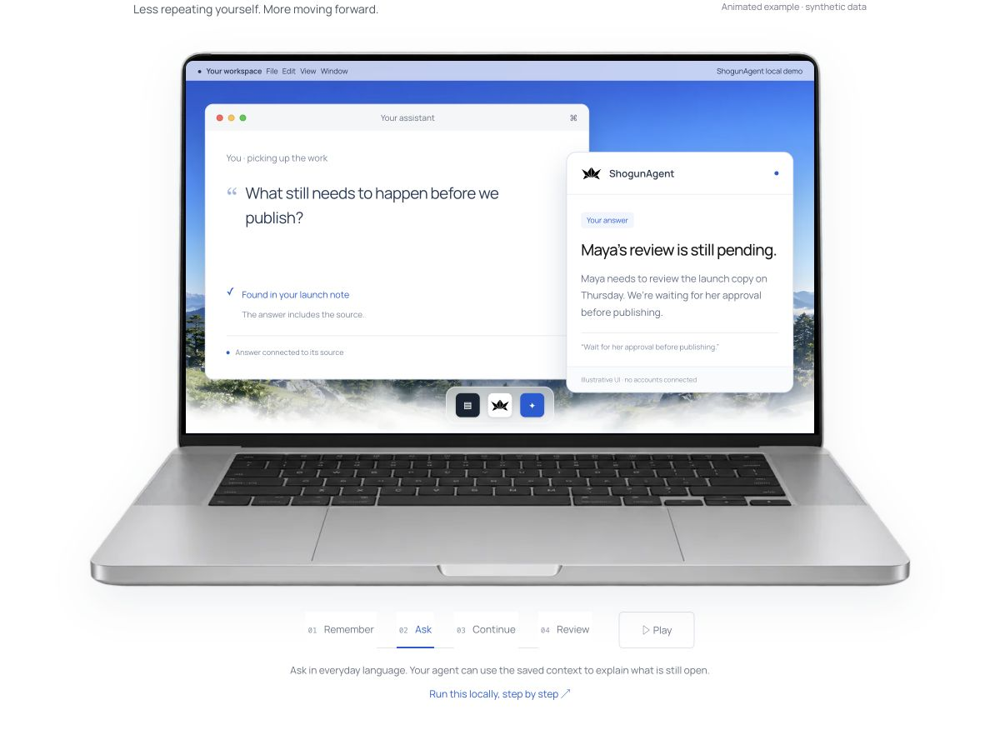
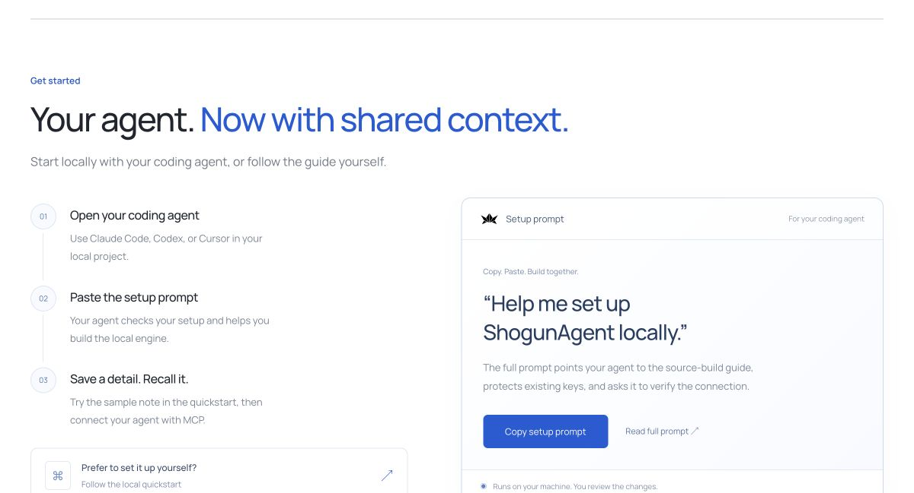

# Website and fresh-user verification

Verified locally on 28 October 2026. This records observed behavior; it does not certify a production deployment or the complete engine feature set.

## Website

- All 18 content pages and the 404 document have valid local destinations: 574 links and fragment references checked.
- All 44 generated pages/assets requested over HTTP returned successfully.
- The three automated website tests passed: navigation/assets, quickstart safeguards, and HTTP routes/content negotiation/404/405 handling.
- Browser checks covered the product and documentation routes, docs filtering and empty results, setup prompt copying, Human/Agent view, FAQ expansion, product tabs, MacBook chapters, relationship graph, timeline update/reset, and the homepage context-handoff animation.
- All three playground scenarios reached simulated approval. Empty source selection disables progression; reset, sample JSON rendering, and JSON download worked.
- At a 390px viewport, mobile navigation opened, navigated to Get started, and closed. No horizontal overflow was observed.
- Browser automation intermittently timed out; affected interactions were rechecked. A download-event wait timed out, but the generated JSON file was verified on disk. Observed browser console errors originated in the installed MetaMask extension.

Run the website checks from the repository root:

```sh
npm run typecheck --prefix apps/web
npm test --prefix apps/web
```

The test command builds its own static output, so it also works in a fresh checkout. The website CI job runs these same checks without installing additional dependencies.

## Fresh local engine setup

The local landing page's quickstart was followed using a fresh public clone of `Torutesu/Shogunagent` at `4e8210fdc16fbd13a04d7b94d7dfbe8fbce4a246`, a new build directory, and a new evaluation store. Existing Rust/compiler dependency caches were available. The macOS toolchain was Rust/Cargo stable 1.97.1, x86_64.

| Check | Observed result |
| --- | --- |
| Exact release build from the guide | Passed in 16m 46s, without source changes or compiler workarounds |
| Private evaluation directory | Directory mode 0700, key/token modes 0600 |
| Repeat initialization | Refused the existing directory; both original keys remained unchanged |
| Server startup | Listening on `127.0.0.1:7464` in multi-principal mode |
| First ingest | Accepted 1, inserted 1, event ID 1 |
| Recall | Returned `The Kestrel demo codeword is violet.` as source evidence |
| Restart with the same key/store | Returned the same event and excerpt |
| Missing/wrong bearer token | HTTP 401 |
| Cross-principal recall without a grant | HTTP 403 |
| Repeated idempotency key | `replayed: true`, `inserted: 0`, same event ID |
| Unknown query | Empty evidence |
| HTTP MCP with the required headers | Initialization, 68-tool listing, `profile.whoami`, and `memory.recall` succeeded |
| Handoff creation/acceptance | HTTP 200; accepted the task into `agent_scratch` |

The execution sandbox initially prohibited binding/accessing localhost; the authorized local tests outside that sandbox succeeded. This was an execution-environment restriction, not an engine failure. Low disk space was resolved by removing only the explicitly approved, regenerable build cache before compiling.

## Initial gaps found before the onboarding follow-up

1. **Publication:** The copied setup prompt points to `shogunagent.com`. The new `/docs/quickstart/` route returned HTTP 404 on the public domain during verification; the local preview serves it. Publish the complete docs alongside the homepage, or supply a usable preview-specific entry point.
2. **Client setup:** The MCP page names the endpoint and bearer header but does not explain required protocol/header behavior. A request containing only those documented headers returned HTTP 400 with `missing_header: Mcp-Method`. Adding `Mcp-Method`, plus `Mcp-Name` for `tools/call`, succeeded. Exact, tested client-specific instructions are still needed. Direct protocol tests do not establish that Claude Code, Codex, Cursor, or Claude Desktop have been connected successfully.
3. **Illustration versus configured behavior:** This quickstart configures lexical retrieval, not model processing or automatic extraction. Recall returned empty `facts` and `items`; handoff creation returned empty `facts` and `entities`. The task-only handoff succeeded, but the rich Maya workflow and relationship graph are browser simulations. A tested extraction/model walkthrough remains necessary.
4. **Engine onboarding copy:** The MCP initialization instructions still describe “ShogunAI” and screen/meeting memory on a Mac. That wording is confusing for the separate ShogunAgent server product.

Actual client integration, model extraction, live provider calls, connector OAuth, external sends, hosted deployment/billing, Windows, and the complete Rust workspace test suite were not validated in this website audit. No external messages or model calls were made, and no deployment was performed.

## Onboarding follow-up (28 October 2026)

Changes were developed on `codex/agent-onboarding`. Production deployment is
separate from this source update. The earlier results above describe the initial audit.

- Added `scripts/mcp-local-bridge.py`: authenticated stdio-to-loopback HTTP with
  per-message `Mcp-Method` / `Mcp-Name`, private token-file loading, no proxy or
  redirects, bounded messages, timeouts, and JSON-RPC errors on transport failures.
  It retains the bearer's permissions; it is not the legacy read-only CLI adapter.
- Added configuration generation for Claude Code, Cursor, Codex, and Claude Desktop,
  exact installation instructions, a no-model protocol check, and a tool-use prompt.
- Added `/docs/state-walkthrough/`, the source processing guide, and the runnable
  `maya_handoff` engine example. The laptop demo now links to this walkthrough.
- Server initialization and discovery now describe ShogunAgent and processing
  prerequisites. The desktop-feature build retains the separate desktop guide.

### Observed client results

| Surface | Observed result | Limit |
| --- | --- | --- |
| Bridge against the running local API | Initialization, tools/list, profile.whoami passed; memory.recall returned the real Kestrel/violet evidence | Direct protocol test, not a model-driven client conversation |
| Claude Code 2.1.220 | `claude mcp list` reported Connected using a temporary config | The conversation test returned “Not logged in”; model-driven tool use is unverified |
| Cursor CLI 2026.09.02-c22c1a3 | Approved the server in an isolated test workspace; discovered 68 tools | Agent conversation required login; this does not verify Cursor's GUI or model-driven tool use |
| Codex CLI 0.164.0 | Generated source configuration loaded in an isolated invocation | Tool dispatch failed in Codex's code-mode host before the requested tools ran; no ShogunAgent tool result was claimed |
| Claude Desktop | Generated the stdio configuration | Application unavailable; not tested in the actual client |

The Codex attempts used its existing sign-in and produced model responses, but
did not execute the requested MCP calls. No client login was fabricated. Normal
user client settings were not overwritten; test registrations stayed in temporary
configuration/workspace directories.

### Engine replay and focused checks

- Maya replay: passed with **scripted Batch answers**, using real ingestion,
  hourly review, source-anchor validation, consolidation, recall, knowledge
  neighbors, and handoff creation/acceptance. There were 2 source sessions,
  3 events, 8 resolved anchors, and no unresolved anchors. Recall returned a
  person, project, commitment, and open loop; handoff included 2 entities and
  2 facts. Writer-scratch recall, exclusion from world-only recall, and duplicate
  acceptance were asserted successfully. No model or relay call occurred in it.
- This exposed an onboarding prerequisite: extracted people/projects mentioned in
  only one hourly source session are hidden from normal recall. The guide now
  explains the two-session visibility rule and completed-hour review window.
- Six bridge regression tests passed, including dynamic headers, notifications,
  token rotation/permissions, remote URL refusal, no redirects, and malformed
  responses. The website build and four tests passed (19 content pages plus 404).
- The focused Rust handshake regression passed, as did 13 existing HTTP MCP
  transport tests and two legacy generated-client-config checks. The new Maya
  example and the working branch’s MCP library also passed Clippy with warnings denied. Workflow YAML, HTTP egress, desktop feature gates, secret
  exposure, and log-hygiene checks passed.
- The exact new example was compiled and run in the prior fresh-build checkout to
  reuse artifacts under disk pressure. Its engine source matches merged main;
  the example file was compared byte-for-byte with the working branch. Server
  onboarding copy was tested separately in the working branch's MCP test build.
  The existing API process used for bridge checks was not replaced; rebuild and
  restart it to see the new initialization wording in a live client.
- Browser verification opened both updated docs pages, checked the sidebar, filtered the new guide, verified command copying by pasting
  it into an input, and observed no desktop horizontal overflow. An initially
  missing sidebar label was fixed and covered by a regression assertion.

**Still needed:** actual model-driven calls after Claude/Cursor login, a working
Codex tool runtime, a Claude Desktop run, and the credentialed production relay
walkthrough. A test relay credential and Claude Desktop were explicitly unavailable.
Full workspace tests and the complete feature matrix were not rerun in this follow-up.

## Agent-neutral setup prompt follow-up (28 October 2026)

The subsequent [Codex context verification](../../docs/codex-context-verification.md)
completed real model-driven save, recall, and source-event calls using isolated
configuration. Fresh sessions retrieved a random phrase and interpreted an
explicit deadline revision; the original source survived a server restart. This
updates the earlier Codex result above without claiming the ordinary client
configuration, automatic extraction, or other clients were verified.

The website setup prompt now detects the current client rather than selecting a
particular product. It covers project-scoped memory instructions, actual client
tool calls, fresh-session validation, and optional second-client setup. It keeps
unavailable login/restart/session steps explicitly pending. It does not claim
universal agent support or automatic whole-chat capture.

The local preview's Copy button and full-prompt endpoint use the preview origin;
static production output retains the public domain. Browser verification confirmed
the 5,056-character clipboard text matched the full prompt and used local guide
URLs, with no agent product names in the prompt. The connection guide now includes
the persistent instruction block and the separate-client connection step. Website
syntax checks and all four tests passed, including local setup references and the
browser module's JavaScript content type. This validates the website/prompt
delivery, not a new end-to-end installation run in every client. Nothing was deployed.

## Actual setup-prompt acceptance follow-up (28 October 2026)

The [full acceptance report](../../docs/setup-prompt-acceptance.md) and
[synthetic tool evidence](../../docs/verification/setup-prompt-acceptance-2026-10-28.json)
record the real website-prompt test in Codex CLI. The setup agent generated the
project's MCP configuration and instructions. Tests exposed a server tied to a
temporary session, mistaken profile/actor guidance, and unnecessary ingest after
a read-only lookup. The prompt and guide were corrected. A stale full-prompt
response after preview rebuilds was also fixed and regression-tested.

After the documented separate-terminal start and client restart, ordinary project
messages triggered actual save/recall through the installed configuration. Four
accepted work sessions made 11 successful MCP calls: initial decision, fresh read,
explicit revision, and another fresh read. Final reads made no writes and reported
an unrecorded budget as unknown. Configuration and private keys survived setup
reruns; the user's temporary trust entry was removed and the original configuration
restored byte-for-byte. The dedicated test server was stopped.

This used an existing engine binary because of limited disk space. The final
read-only instruction correction was installed and retested separately, not by
repeating a clean-machine build. Other clients and automatic extraction remain
unverified. The four website tests and six bridge tests passed; nothing was pushed
or deployed.

## Visual review

These screenshots show illustrative browser UI, not a live connection to the engine.




